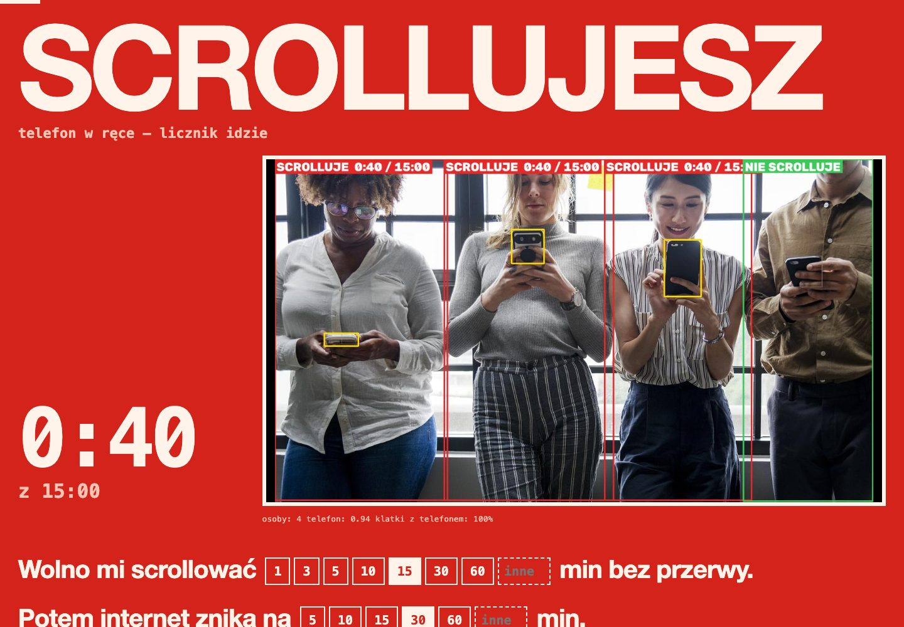
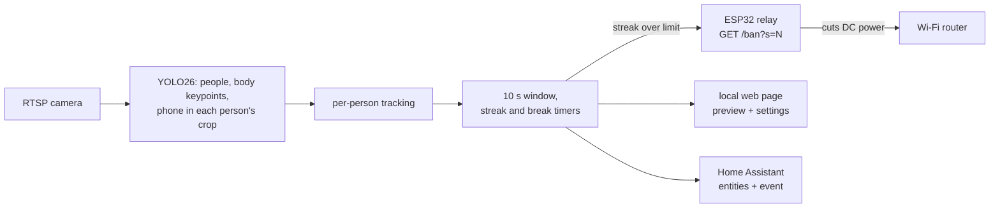

# Scroll Guard

A camera in the corner of the room notices when you have been scrolling your phone for too long, and an ESP32 cuts the power to your Wi-Fi router for a while.

Everything runs locally. No cloud, no app on the phone, no account.



<sub>Demo photo: "Nomophobia" by Rawpixel, CC0, via Wikimedia Commons. The UI is in Polish: *scrolluje* = scrolling, *nie scrolluje* = not scrolling, *wolno mi scrollować … min bez przerwy* = I may scroll … min without a break.</sub>

## How it works



1. **Find people.** YOLO26 runs on the full frame (up to 4 people) and a pose model finds the face, shoulders and wrists of each one.
2. **Find the phone per person.** Each person is cropped from the full-resolution frame, upscaled, and searched for a phone (COCO class 67). From the far corner of a room a phone is only a few dozen pixels wide, and this step is what makes it detectable.
3. **Decide whether the phone is in use.** A phone counts only when it belongs to that person (inside their box, nearest wrist) and is near their face. Distances are measured in shoulder widths, so the same rule works sitting, lying down, near or far. A phone lying on the desk does not count. **The face has to be visible.** With your back to the camera, a phone next to your hand is usually just lying on the desk.
4. **Time it.** Every person gets their own timer. The decision uses the last 10 seconds, not single frames. Short gaps (hands in front of the face, a missed frame) do not reset the streak; only a break longer than the one you set does.
5. **Cut.** When someone's streak passes the limit, the server calls the ESP32: `GET /ban?s=<ban length>`. The ESP32 opens the router's DC line and closes it again **by itself** when the time is up, because once the router is off nobody can reach it.

It cannot see your thumb moving from across the room. It detects "phone held up in front of you" and decides from how long that lasts.

## What you need

| | |
|---|---|
| Camera | any IP camera with RTSP, mounted so it sees faces where you scroll (bed, sofa, desk). Tested with TP-Link Tapo (`stream1`, the full-resolution stream). |
| Computer | runs the detection: a Mac with Apple Silicon (uses the GPU), a PC with Python 3.10+, or a Home Assistant host (add-on, CPU). |
| ESP32 + relay | ESP32 DevKit or ESP32-C3, a 1-channel 5 V relay module, two 5.5×2.1 mm DC pigtails, a USB charger. Full parts list: [docs/hardware.md](docs/hardware.md). |

Without the ESP32 it still works as a counter: it shows and logs everything, it just doesn't cut anything (dry run).

## Hardware


- Only the router's **low-voltage DC line** is switched. Never switch mains with this.
- The router is fed through **NC** (normally closed): relay off, ESP unplugged or crashed = internet on.
- The ESP32 has its own USB charger. Don't power it from the router.
- Optional bypass switch across the relay: closed = internet always on.

Parts list, wiring steps and the relay trigger-level trap: [docs/hardware.md](docs/hardware.md).

## Setup

### 1. Firmware (ESP32)

```bash
cp firmware/scroll_guard_relay/config.example.h firmware/scroll_guard_relay/config.h
# edit config.h: Wi-Fi name and password, optionally API_TOKEN
```

Arduino IDE: open `firmware/scroll_guard_relay/scroll_guard_relay.ino`, board package **esp32 by Espressif** (tested with 3.3.3), board "ESP32 Dev Module" or "ESP32C3 Dev Module", upload.

arduino-cli:

```bash
arduino-cli core install esp32:esp32 --additional-urls https://espressif.github.io/arduino-esp32/package_esp32_index.json
arduino-cli compile --upload -p <port> --fqbn esp32:esp32:esp32 firmware/scroll_guard_relay
# ESP32-C3: --fqbn esp32:esp32:esp32c3
```

Check it: `http://scroll-guard.local` (or the IP from your router) shows whether the internet is on or cut. `http://scroll-guard.local/ban?s=10` cuts it for 10 seconds; `/unban` brings it back at once. Holding the BOOT button for 2 s also restores it by hand.

### 2. Server (Mac / Linux / Windows)

```bash
cd scroll_guard/app
python3 -m venv .venv
.venv/bin/pip install -r requirements.txt
.venv/bin/python serwer.py          # on a Mac you can also double-click start.command
```

Open http://127.0.0.1:8911. In **WIĘCEJ** (more) enter:

- **the camera's RTSP URL.** Use the main, full-resolution stream. Tapo: `rtsp://<user>:<password>@<camera-ip>:554/stream1` (camera account set in the Tapo app, under Advanced settings → Camera account).
- **the ESP32 address**, e.g. `scroll-guard.local` or its IP. Leave it empty for a dry run.
- **the ESP token**, only if you set `API_TOKEN` in `config.h`.

Then pick the limit, the ban length and the break that resets the counter on the main page.

The YOLO26 weights (about 95 MB for the full set, less for the light one) download automatically on the first start into `scroll_guard/app/modele/`. Settings are saved to `scroll_guard/app/ustawienia.json`, which is git-ignored because it holds the camera password.

Options:

| | |
|---|---|
| `--port 8911` | web page port |
| `--lan` | listen on the whole network (e.g. to look at it from your phone). There is no login, so use it only on a network you trust. |
| `--zrodlo <src>` | override the source: an RTSP URL, a video or image file (loops), a camera index like `0`, or `mac` for the Mac's built-in camera through ffmpeg |
| `SCROLL_GUARD_MODELE=lekkie` | env var: smaller models (`yolo26n-pose` + `yolo26s`) for slower CPUs |

On macOS the process that reads the built-in camera needs camera permission. `start.command` runs from Terminal, which usually has it.

### 3. Home Assistant add-on (optional)

The same server packaged as an add-on, with the page in the HA sidebar and entities for automations. See [scroll_guard/DOCS.md](scroll_guard/DOCS.md).

- **From this repository** (public repos only): Settings → Add-ons → Add-on store → ⋮ → Repositories → add `https://github.com/yoobzz/scroll-guard`.
- **As a local add-on:** copy the `scroll_guard/` folder into `/addons/` on the HA host (Samba share or the SSH add-on), then Add-on store → ⋮ → Check for updates. It appears under "Local add-ons".

The add-on publishes `binary_sensor.scroll_guard_scrolling`, `binary_sensor.scroll_guard_internet_cut`, `sensor.scroll_guard_streak`, `sensor.scroll_guard_ban_remaining`, `sensor.scroll_guard_people`, and fires the event `scroll_guard_ban` on every cut.

## API

ESP32 (`/status`, `/ban`, `/unban`), the server's HTTP API and the HA entities: [docs/api.md](docs/api.md).

## Limitations

- **The face must be visible.** Sitting with your back to the camera is not detected (on purpose: that's how it avoids counting phones lying on the desk).
- **Night / IR mode is untested.** Phones are much harder to see in grey IR images.
- **Mobile data bypasses it.** It cuts Wi-Fi, not your SIM.
- **The whole LAN goes down during a ban.** The camera, the ESP32 and HA lose the network too. That's why the ESP32 keeps the timer itself. After the ban the router needs 1–3 minutes to boot.
- **Analysis must keep up.** Each frame should be analysed in under about 4 s (shown under the preview as "analiza klatki"). Slower than that and the timers stop counting reliably. Measured with 4 people in view: about 0.4 s on an Apple M5 (GPU, full models), about 1.9 s in the add-on on 4 CPU cores (light models). Fewer people = faster. On a weak CPU use the light models.
- **Up to 4 people** are checked per frame. Anyone scrolling past the limit triggers the ban for everyone.
- **The UI is Polish.** The code comments and identifiers are mostly Polish too. Docs and the firmware are English.

## Privacy

Video never leaves your network. Frames are analysed in memory and not saved. The camera password lives only in `ustawienia.json` (or in the add-on's options) on your machine. The page listens on `127.0.0.1` unless you pass `--lan`. POST requests must be `application/json` and have a local `Host`, which blocks other websites from changing the settings through your browser.

## Development

```bash
cd scroll_guard/app
python -m unittest discover -s tests          # needs only numpy
python tests/sprawdz_obrazy.py <photos_dir>   # detector check on photos: poz_*.jpg = phone, neg_*.jpg = no phone
```

CI runs the unit tests and compiles the firmware for ESP32 and ESP32-C3.

## License

[AGPL-3.0](LICENSE). The detection uses [Ultralytics YOLO](https://github.com/ultralytics/ultralytics) (AGPL-3.0) and its YOLO26 weights, so the whole project uses the same license.
