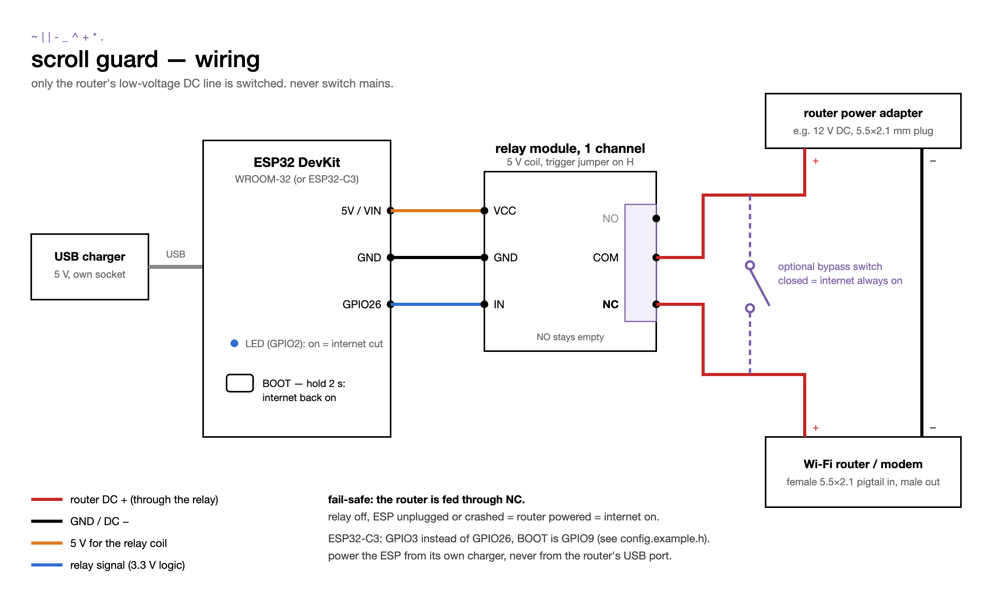

# Hardware

The relay board sits between the router and its power adapter and opens the router's DC line during a ban. It is a small, low-voltage build: no soldering is strictly needed if you use screw-terminal pigtails.

## Parts list

| # | Part | Spec | Qty | Notes |
|---|---|---|---|---|
| 1 | ESP32 board | ESP32 DevKit (WROOM-32, 30 or 38 pin) **or** ESP32-C3 DevKit / SuperMini | 1 | Any board with 2.4 GHz Wi-Fi and the Arduino core. Pins for both are preset in `config.example.h`. |
| 2 | Relay module | 1 channel, **5 V coil**, contacts rated at least 10 A / 30 V DC, with an **H/L trigger jumper** | 1 | Often sold as "1-channel 5V relay module with optocoupler, high/low level trigger". See [Relay trigger level](#relay-trigger-level). |
| 3 | DC pigtails | 5.5×2.1 mm barrel, one **female** and one **male**, with screw terminals or bare wires | 1 pair | Measure your router's plug first: some use 5.5×2.5 mm or 3.5×1.35 mm. |
| 4 | Jumper wires | female–female Dupont | 3 | 5V, GND, signal. |
| 5 | USB charger + cable | 5 V, 1 A or more; micro-USB or USB-C to match the board | 1 | The ESP32 must **not** be powered from the router (it would switch itself off). |
| 6 | Bypass switch *(optional)* | SPST toggle, rated above the router's current (3 A is plenty for most) | 1 | Wired across the relay contacts: closed = internet always on. |
| 7 | Small parts *(optional)* | lever connectors (Wago 221) or a screw terminal block, heat-shrink, a small enclosure | – | For the DC minus line and to keep things tidy. |
| 8 | Camera | IP camera with RTSP, **or** an ESP32 camera board (ESP32-CAM / XIAO ESP32S3 Sense), **or** the laptop's own camera | 1 | Tested: TP-Link Tapo (`stream1`). It must see faces where you scroll. Comparison: [cameras.md](cameras.md). |
| – | Tools | small screwdriver, multimeter | – | The multimeter is for checking the polarity of the DC plug. |

The router's own power adapter stays as it is. Typical routers take 12 V at 1–2 A, well inside the relay's rating.

## Wiring

### ESP32 → relay module

| ESP32 DevKit | ESP32-C3 | Relay module |
|---|---|---|
| 5V / VIN | 5V | VCC |
| GND | GND | GND |
| GPIO26 | GPIO3 | IN |

Set the module's trigger jumper to **H** (high level trigger) and leave `RELAY_ACTIVE_LOW 0` in `config.h`.

### Router DC line → relay contacts

1. Plug the router's adapter into the **female** pigtail. Plug the **male** pigtail into the router.
2. Check polarity with the multimeter (most routers are centre-positive, but check). Mark the + wires.
3. **Minus:** join the two minus wires straight through (lever connector or terminal).
4. **Plus:** female pigtail + → relay **COM**. Relay **NC** → male pigtail +.
5. Leave **NO** empty.
6. *(optional)* Bypass switch between **COM** and **NC**.
7. Power the ESP32 from its own USB charger, in a different socket from the router if you can.

### Why NC

With the router on the normally-closed contact, the relay has to be actively energised to cut the internet. If the ESP32 crashes, is unplugged or loses power, the relay drops and the router comes back. It fails open, toward internet on, never toward a stuck-off router.

### Why only DC

The relay switches the router's 5–12 V DC supply, never 230 V / 120 V mains. These relay modules and jumper-wire builds are not made for mains. If you want to switch a mains plug, use a certified smart plug instead (see [Without the ESP32](#without-the-esp32)).

## Relay trigger level

This is the most common reason a build "doesn't work".

Cheap 5 V relay modules are usually **low-level triggered**: the input drives an optocoupler LED whose other side sits at 5 V. An ESP32 output is only 3.3 V when high, so even "off" leaves about 1.7 V across that LED. On many modules that is enough to keep the relay pulled in, or to make it chatter.

What works reliably:

- **A module with an H/L jumper, set to H** (recommended). The input is active-high and 3.3 V switches it cleanly. Use `RELAY_ACTIVE_LOW 0`.
- A relay module with a 3.3 V coil, powered from the 3V3 pin. Use `RELAY_ACTIVE_LOW 0`, unless the module says low-level trigger.
- A low-trigger module, with `RELAY_ACTIVE_LOW 1`. Use this only after you have checked that it really releases when the pin is high. Test with `/ban?s=10` and listen for the click both ways.

The firmware sets the relay to "off" before anything else at boot, so the router is not cut while the ESP32 starts.

## Pins and buttons

| | ESP32 DevKit | ESP32-C3 |
|---|---|---|
| Relay signal | GPIO26 | GPIO3 |
| BOOT button (hold 2 s = internet back on) | GPIO0 | GPIO9 |
| Status LED (on = internet cut, blinking = no Wi-Fi) | GPIO2 | none (most C3 boards have an RGB LED that needs a driver) |

All of these can be changed in `config.h`. Avoid the strapping pins (ESP32: 0, 2, 5, 12, 15; ESP32-C3: 2, 8, 9) for the relay signal.

## Firmware behaviour

- The ESP32 owns the ban timer. When the router goes off, Wi-Fi goes with it and nothing can reach the ESP32 until the ban is over, so it switches the relay back by itself.
- `MAX_BAN_SECONDS` (default 4 h) caps every ban, whatever the server asks for.
- A new `/ban` never shortens a running ban. It only extends it.
- `API_TOKEN` (optional): when set, `/ban` and `/unban` need `?key=<token>`. Put the same value into the web page (More → ESP32 key) or the add-on's options.
- The board answers on `http://scroll-guard.local` (mDNS) and reconnects to Wi-Fi on its own after the router comes back.

## Without the ESP32

If you run the Home Assistant add-on, you can skip the relay and let an automation switch the router's plug off on the `scroll_guard_ban` event, then back on after `seconds`. Use a **Zigbee or Z-Wave** plug, whose radio talks to HA directly. A Wi-Fi plug loses its connection to HA when the router goes off and could not be switched back on remotely.
